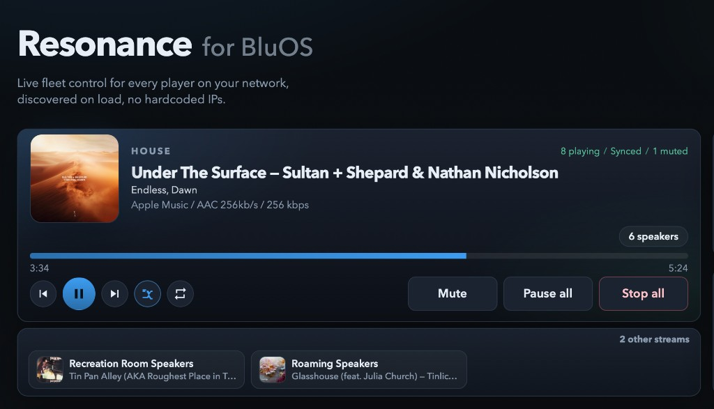

# Resonance for BluOS

[](https://github.com/tbaur/resonance/actions/workflows/test.yml?query=branch%3Amain)
[](https://github.com/tbaur/resonance/actions/workflows/codeql.yml?query=branch%3Amain)
[](https://github.com/tbaur/resonance/releases/latest)
[](LICENSE)
[](https://www.python.org/downloads/)
[](https://nodejs.org/)
[](https://www.typescriptlang.org/)
[](https://mypy-lang.org/)

Resonance controls every BluOS player on your network: Nodes, Pulse, NAD CI zones, and the rest. It discovers the fleet (mDNS + LSDP), then keeps house-wide playback, volume, grouping, and presence live in the browser.



## Features

- **House remote** — one focused stream: artwork, title, album, source, live seek, and transport. The speaker count opens every player on that stream. Other streams sit underneath; choosing one keeps the panel on those players. Mute, Pause all, and Stop all stay on the row.
- **Fleet** — every player, live now-playing, A–Z or clustered by sync group (auto-switches to Sync when a group forms).
- **Volume** — **Bluesound** (bluesound.com Nodes/Pulse) and **NAD CI S2** are separate sliders (different amp scales). Bluesound has 20 / 48 / 60 chips; CI S2 has 42 / 50 / 60 / 70. Other brands (NAD C658, …) use the player row only.
- **Multi-room** — create groups, add/remove followers, group all free rooms under a lead, ungroup one set or all. Break-all also clears orphans whose primary left the network.
- **Per player** — queue (loaded on open, optimistic reorder), inputs / presets / Bluetooth / settings when Advanced is opened, diagnostics (uptime from the device web UI), 12-hour presence bar and last drop, reboot. Leaving the page aborts diagnostics and upgrade scrapes so Skip and queue moves are not starved by the browser’s six connections per host.
- **House page** — the same remote, then Health (poller drop history for this server process, 24h, not persisted), device firmware and an upgrade check, break all groups, rescan, and reboot all.
- **Discovery** — at process start, on **Rescan**, and on the poller clock when the fleet is empty or the discovery cache expires. Page load and house mute/volume read the live snapshot (no mDNS). mDNS browses `_musc` and `_musp`, and LSDP listens on UDP 11430. Either one finds a CI secondary zone as its own `ip:port`.
- **Phones and tablets** — below 900px, which covers phones and most iPads in portrait, the fleet list becomes room cards: name, now playing, volume, mute, and play/pause. Prev, Next, Stop, and the IP stay on the player page. Phones also get a top-right menu with page links and Rescan. On touch screens, buttons grow to 44pt and chips to 36pt, including in the desktop table on an iPad in landscape. Add Resonance to the home screen of an iPhone or iPad to run it full screen without Safari's bars. The home-screen app has its own cookies, separate from Safari's, so a tokened server asks for the API token there too.
- **Live updates** — one etag long-poll per player, plus SSE. A room holds `/Status`. A grouped follower holds `/SyncStatus` instead, so its own mute and volume show up at once, and it takes the track from the group lead. Holding both at once fills the player's HTTP slots, and the room then looks down while the music keeps playing. Seek interpolates between snaps. REST fallback if the stream drops.

Ops (health, logs, LAN bind): [docs/RUNBOOK.md](docs/RUNBOOK.md).

## Requirements

- Python 3.11+ (CI: 3.11, 3.13, 3.14, 3.15)
- Node.js 22+
- Same LAN as your players

## Quick start

```bash
make serve     # everyday use: builds the UI, then serves UI and API at http://127.0.0.1:8780/
make run       # development: API with reload at :8000, then the Vite UI at http://127.0.0.1:8765/
```

Both install dependencies on first use and can run at the same time. Run `make` with no target to list the rest: `build`, `lint`, `test`, `check`, `clean`, `distclean`.

For a LAN bind, set `RESONANCE_HOST=0.0.0.0` and `RESONANCE_API_TOKEN` in the repo-root `.env`, and the same token as `VITE_API_TOKEN` in `frontend/.env` (Vite does not read the repo-root file). `make serve` and `make run` pick up both. Without a token, a non-loopback bind logs an `insecure_bind` warning and leaves every control open to the LAN. Copy [.env.example](.env.example) when you need non-default settings.

Full setup and checks: [CONTRIBUTING.md](CONTRIBUTING.md). Two-terminal start: [docs/RUNBOOK.md](docs/RUNBOOK.md). Variables: [docs/CONFIGURATION.md](docs/CONFIGURATION.md).

## Docs

- [Configuration](docs/CONFIGURATION.md) — `RESONANCE_` variables, discovery, network exposure
- [Runbook](docs/RUNBOOK.md) — start, health, failures, logs
- [Changelog](CHANGELOG.md) — released history (generated by release-please)
- [Security](SECURITY.md)
- [Code of Conduct](CODE_OF_CONDUCT.md)
- [Releasing](RELEASING.md)
- [Contributing](CONTRIBUTING.md)

## Trademarks

Resonance is an independent project. It is not affiliated with or endorsed by Bluesound, NAD, or Lenbrook. BluOS, Bluesound, and NAD are trademarks of Lenbrook Industries Limited.

## License

Copyright 2026 tbaur

Licensed under the Apache License, Version 2.0. See [LICENSE](LICENSE) file for details.
